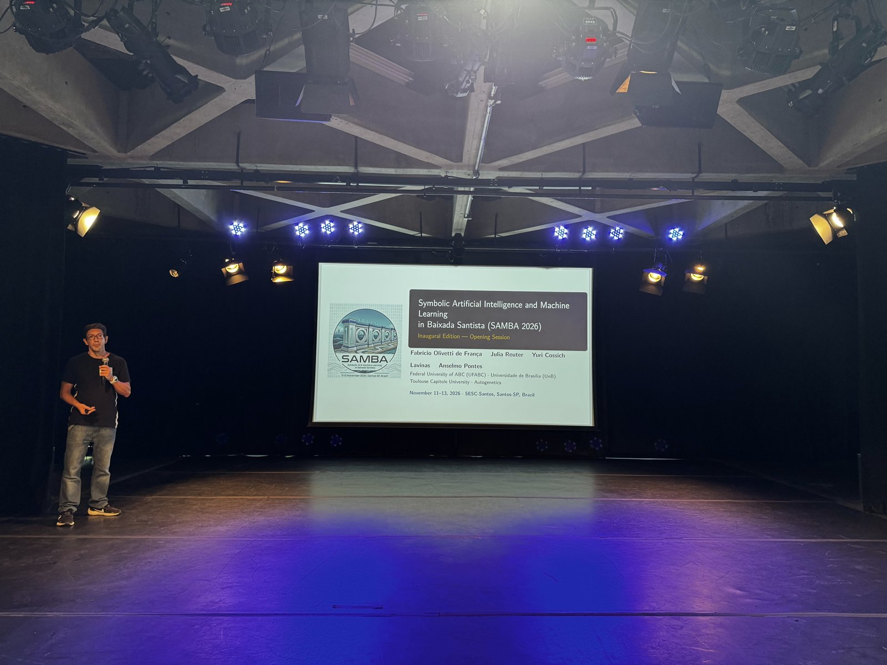
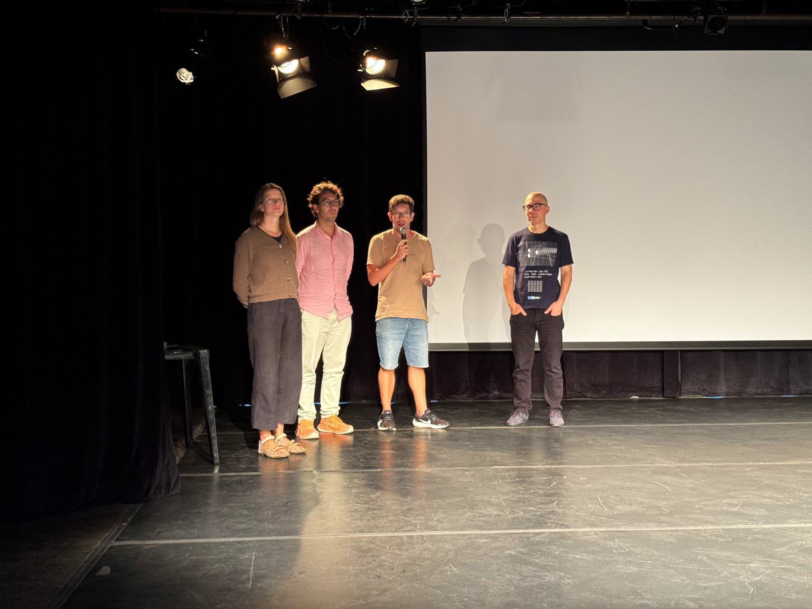
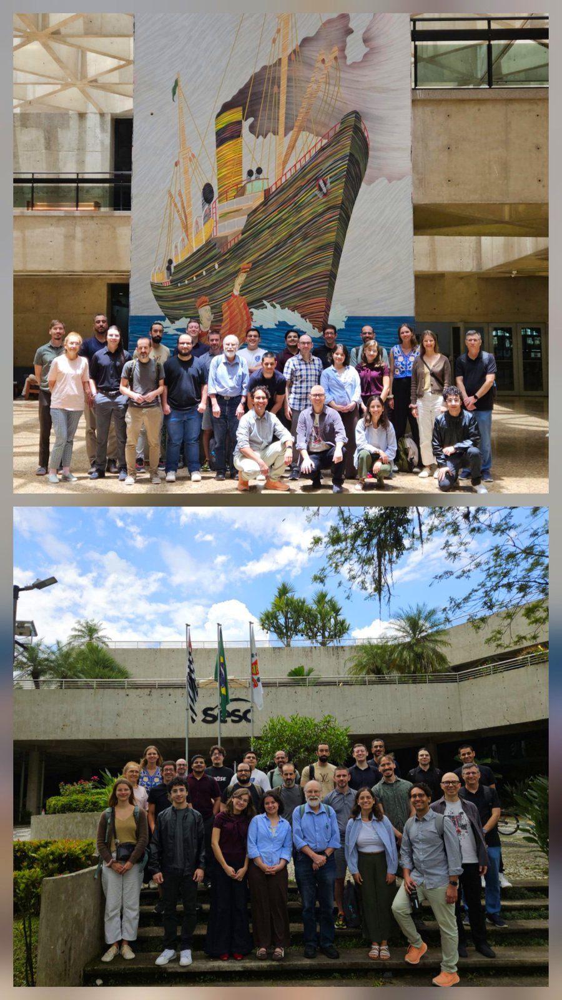

Post by Fabricio Olivetti de França

The inaugural edition of **[Symbolic Artificial Intelligence and Machine Learning in Baixada Santista (SAMBA)](https://samba-workshop.github.io/)** took place from the 11th to the 13th of November 2026 at SESC-Santos in Santos-SP, Brazil.

SAMBA is an international scientific meeting bringing together Brazilian and international universities, research centers, and companies working in symbolic AI and ML. Co-organized by the Federal University of ABC (UFABC), Universidade de Brasília (UnB), Toulouse Capitole University, and Autogenetics (and sponsored by Autogenetics), the event was hosted at SESC-Santos in the coastal city of Santos and was open to the general public free of charge.

<!--more-->

The topics of this workshop were probabilistic and Bayesian symbolic regression, theoretical foundations of evolving AI systems, modularity and feature construction in genetic programming, and interpretable machine learning across domains ranging from astrophysics to public-sector data auditing. Several talks emphasized principled uncertainty quantification, prior formulation, and Markov Chain Monte Carlo (MCMC) dynamics in symbolic search. Other speakers highlighted how modularity and automatic discovery of function libraries can scale genetic programming to complex tasks such as biomedical image classification and interpretable control.

What are the central themes driving the field forward? Wolfgang Banzhaf (Michigan State University) opened the scientific program by connecting phenotypic entropy and simplicity bias toward an entropic law for evolving AI systems. Another important focus throughout the workshop was **Bayesian and probabilistic symbolic regression and the theoretical limits of symbolic learning**. Instead of treating model discovery as a purely deterministic optimization problem, several speakers examined how prior knowledge, structural priors, and stochastic sampling govern equation discovery. The talks by Roger Guimerà (Rovira i Virgili University, *Bayesian symbolic regression and the limits of symbolic learning*) and Geoffrey Bomarito (NASA, *Priors in Bayesian Symbolic Regression: Separating Size and Structure*) directly addressed the foundational role of priors and fundamental boundaries in symbolic learning. Somjit Roy (Texas A&M University) presented operator-induced and regularized symbolic forests for probabilistic equation discovery, while Julia Reuter (UFABC) presented an analysis of the search dynamics in Bayesian SR, to better understand how stochastic local search navigates the space of mathematical expressions.

Another key piece is **enhancing expressiveness, modularity, and search efficiency in Genetic Programming (GP)** without sacrificing interpretability. Standard symbolic representations can suffer from dimensional collapse or struggle to scale to high-dimensional control and classification tasks. Sylvain Cussat-Blanc (University of Toulouse) demonstrated how allying Cartesian Genetic Programming (CGP) and Tangled Program Graphs (TPG) fosters emerging modularity in biomedical image classification, while Christina Berghegger (University of Toulouse) showed how specializing experts via the automatic discovery of function libraries can improve modular reuse. On the search and representation front, Alessandro Lucantonio (Aarhus University) introduced Adaptive Stagewise Symbolic Regression, Renato Tinós (USP) explored variable interaction and importance estimation to simultaneously enhance evolutionary search and interpretability, and Ícaro Marcelino Miranda (Santo Digital) addressed preventing dimensional collapse in GP feature construction.

Finally, **real-world applications, system trustworthiness, and reliable benchmarking** grounded the methodological discussions. On the physical sciences and engineering side, Phelipe Darc (CBPF) demonstrated how symbolic regression bridges numerical simulations and scaling laws in binary neutron star mergers, Giorgia Nadizar (University of Toulouse) presented interpretable control systems, and Rafael Ávila dos Santos (Unicamp) proposed a neuroevolutionary multigenic GP algorithm for system identification. Looking at societal and empirical reliability, Fernando Costa (UnB) proposed using symbolic regression to audit synthetic public-sector tabular data generated with differential privacy, and Daniel Henrique Serezane Pereira (Unesp) closed the technical sessions by answering the call for more reliable black-box benchmarks for symbolic regression.

We also had the opportunity to bring the students from UFABC to interact and engage with the experts in the field.

Thank you to all the speakers and participants for the well-prepared talks, lively debates, insightful discussions, and an outstading canoe ride along the Brazilian coast. Until next time!

    

        <figure class="image-box">
            
        </figure>
    

    

        <figure class="image-box">
            
        </figure>
    

    

        <figure class="image-box">
            
        </figure>
    

    

        <figure class="image-box">
            
        </figure>
    

Workshop Organizers: Yuri Cossich Lavinas (Toulouse Capitole University / UnB), Julia Reuter (UFABC), Fabricio Olivetti de França (UFABC), Anselmo Pontes (Autogenetics)
